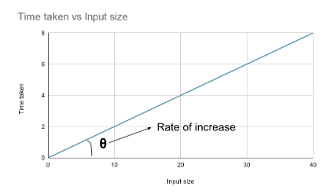

# Index Of Content

```
DSA Basic:

Pattern
Math Question
Number System

---

Linear Data Structures:

Array
Stack
Queue
LinkedList

---

Non Linear Data Structures:

Tree
Graph
Strings
Tries

---

Algorithms:

Sorting Techniques
Sliding Windows & Two Pointers
Bit Manupulation
Recursion
Greedy
Dynamic Programming

```

# Data Structures

Data structures is a particular way of storing and organizing data in a computer so that it can be used efficiently.

1. Linear data structure:
    - Elements are accessed in sequential order. (but not necessarily stored in sequential order)
    - Arrays, Linked List, Stack, Queue
2. Non-linear data structure:
    - Elements are accessed in non-sequential order.
    - Trees, Graphs, HashMap

# Algorithm

- Algorithm is a sequence of steps to solve the given problem.
- Rate of Growth - Rate at which execution time or space increase, as the size of problem (input size, **n**) increase.
  `1 < logn < sqrt(n) < n < nlogn < n^2 < n^3 < 2^n < n!`.
- Time Complexity - It is described as rate at which algorithm's execution time increase as the size of the input data increases.
- TC ≠ Time taken by algorithm to execute
- Space Complexity - It is described as rate at which algorithm's required auxiliary space increase as the size of the input data increases.
- SC ≠ Space required by algorithm to execute

Note: Auxiliary space refers to the space that we use additionally to solve a problem. And input space refers to the space that we use to store the inputs.



# Types of Input (n)

To analyze the given algorithm, we need to know, for which input the algorithm take less time and for which input the algorithm take longer time.

- **Worst case:** Defines the input for which the algorithm takes longer time.
- **Best case:** Defines the input for which the algorithm takes least time.
- **Average case:** Run the algorithm for different input, compute total run time and divide by number of trials.

# Mathematical Form of Program

f(n) = time taken by algorithm to execute, as a function of input size n.

## 1. Constant operations:

```java
int x = 4 +  5;   // constant time
x++;              // constant time
```

## 2. Loops

```java
for(int i=0; i<n; i++){  // executes n time
	m = m + 2;             // constant time, c
}
```

Total time = f(n) = constant c \* n = cn

## 3. Nested Loops

```java
for(int i=0; i<n; i++){    // outer loop executes n time
	for(int j=0; j<n; j++){  // inner loop executes n time
		k = k + 1;             // constant time, c
	}
}
```

Total time = f(n) = c _ n _ n = cn²

Special case:

```jsx
for(int i=0; i<n; i++){    // outer loop executes n time
	for(int j=0; j<=i; j++){  // inner loop executes n time
		k = k + 1;             // constant time, c
	}
}
```

Here the constant operation `k = k + 1;` executed 1 + 2 + 3 + … + n times.

The sum of 1 + 2 + 3 + … + n = n(n+1)/2. = n²/2 + n/2.

Total time = f(n) = n²

## 4. Consecutive Statement

Add the time complexity of each statement.

```java
x = x + 1;               // constant time, c0

for(int i=0; i<n; i++){  // executes n time
	x = x + 2;             // constant time, c1
}

for(int i=0; i<n; i++){    // outer loop executes n time
	for(int j=0; j<n; j++){  // inner loop executes n time
		k = k + 1;             // constant time, c2
	}
}
```

Total time = f(n) = c₀ + c₁n + c₂n²

## 5. If else statement

Worst case running time - the test condition + either if block or else block (whichever is the larger)

```java
if(arr.length == 0){     // test - constant c0
	return false;          // constant c1
}
else {
	for(int i=0; i<n; i++){  // executes n time
		x = x + 2;             // constant time, c2
	}
}
```

Total time = f(n) = c₀ + c₂n

## 6. Logarithmic complexity

Cut the problem size by fraction (usually by 1/2)

```java
for(int i=1; i<n; i=i*2){  // executes ? time
	x = x + 2;               // constant time
}
```

Value of i in each step `i = 1,2,4,8…` which is `i = 2^0, 2^1, 2^2, 2^3…`

Assume the loop executes k time. At kth step 2^k ≤ n and at k+1 th step we come out the loop.

Taking log on both sides

log(2^k) ≤ log(n)

k log(2) ≤ log(n)

k ≤ log2(n)

So, loop executes k = log2(n) times at max.

This also works for decreasing loop

```java
for(int i=n; i>1; i=i/2){  // executes ? time
	x = x + 2;               // constant time
}
```

Total time = f(n) = log2(n)

Log10(n) Time complexity

```java
for(int i=1; i<n; i=i*10){
	x = x + 2;
}

for(int i=n; i>1; i=i/10){
	x = x + 2;
}
```

## 7. Sqrt complexity

```java
for(int i=0; i<sqrt(n); i++){   // executes sqrt(n) time
	x = x + 2;                    // constant time
}

for(int i=0; i*i<n; i++){       // executes sqrt(n) time
	x = x + 2;                    // constant time
}
```

Total time = f(n) = sqrt(n)

## Example

```
f(n) = n^4 + 100n^2 + 10n + 50

50      - 50, contant operation
10n     - 10, loops
100n^2  - 100, nested loop
n^4     - 1, four level nested loop
```

# Asymptotic Notation

Approximation of given function.

Here g(n) is approximation function - of f(n). And f(n) is ‘Mathematical form of program’.

## Big-O Notation (Oh):

- Gives tight upper bound approximation of given function.
- Meaning of “tight” in tight upper bound - there will be many upper bound available for given function but “tight” represents **closest** upper bound.
- Representation: `f(n) = O(g(n))`
- Condition: `f(n) ≤ cg(n)`
  Where c ≥ 0, and n ≥ n0

**Note:**

O(g(n)) is set of all functions with smaller or same order of growth as g(n). for example, O(n²) includes O(1), O(n), O(nlogn) etc.

- O(1) includes :- 100, 1000, 200, 1, 20 etc.
- O(n) includes :- 3n + 100, 100n, 2n-1, 300, etc.
- O(nlogn) includes :- 5nlogn, 3n-100, 2n-1, 10n, 100 etc.
- O(n²) includes :- 10n², n²+100, 5n-10, 5 etc.

- Q. Find upper bound for f(n) = 3n + 8
    ```
    3n + 8 ≤ 4n for all n ≥ 8
    hence 3n + 8 = O(n) with c = 4 and n0 = 8
    ```
- Q. Find upper bound for f(n) = n² + 1
    ```
    n² + 1 ≤ 2n² for all n ≥ 1
    hence n² + 1 = O(n²) with c = 2 and n0 = 1
    ```
- Q. Find upper bound for f(n) = n^4 + 100n^2 + 50
    ```
    n⁴ + 100n² + 50 ≤ 2n⁴ for all n ≥ 11
    hence n⁴ + 100n² + 50 = O(n⁴) with c = 2 and n0 = 11
    ```

Note: There is no unique value for n0 and c in proving the asymptotic bound.

## Big-**Ω** Notation (Omega):

- Gives tight lower bound approximation of given function
- Meaning of “tight” in tight lower bound - there will be many lower bound available for given function but “tight” represents **closest** lower bound.
- Representation: `f(n) = Ω(g(n))`
- Condition: `cg(n) ≤ f(n)`
  Where c ≥ 0 and n ≥ n0

## Big-**Θ** Notation (Theta):

- Gives tight bound approximation of given function
- Meaning of “tight” in tight bound - there will be many bound available for given function but “tight” represents **closest** upper & lower bound.
- Representation: `f(n) = **Θ**(g(n))`
- Condition: `c1 g(n) ≤ f(n) ≤ c2 g(n)`
  Where c1, c2 ≥ 0 and n ≥ n0
