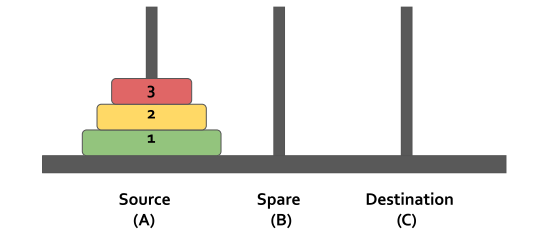

# Stack

- Stack is a linear data structure that provides last in first out (LIFO) insertion or remmoval of element.
- One way to implement the stack is to have a data structure where an array is used to store the elements in the stack.
- Variable called `top` keeps the location of topmost element in the stack (array).


# Stack Operations

Basic Stack Operations includes...

- push `O(1)`
- pop `O(1)`
- peek `O(1)`
- isEmpty (underflow) `O(1)`
- isFull (overflow) `O(1)`
- size `O(1)`

Note:

- While performing pop operation check if stack is already empty or not.

# Implementation

```Java
import java.util.*;

class Stack<T> {
    private Vector<T> items;

    public Stack() {
        items = new Vector<T>();
    }

    public void display() {
        System.out.println(items);
    }

    public void push(T element) {
        items.add(element);
    }

    public boolean isEmpty() {
        return items.size() == 0;
    }

    public T pop() {
        if (isEmpty())
            return null;
        int lastIndex = items.size() - 1;
        return items.remove(lastIndex);

    }

    public T peek() {
        if (isEmpty())
            return null;
        int lastIndex = items.size() - 1;
        return items.get(lastIndex);
    }

    public int size() {
        return items.size();
    }
}
```

# Application of Stack

- Polish Expressions and their compilation.
- Decimal to Binary conversation
- Tower of Hanoi
- Recursion (Recursion internally uses stack as data structure to store function's PCB).

### Infix, Postfix, Prefix

- Infix, Postfix, Prefix notations are three different but equivalent notations of writing algebraic expressions.
- Stacks are primarily used to convert an expression from one form to another and to evaluate those expressions.
- Prefix is parenthesis free notation (<u>Polish Notation</u>)
- Postfix is reverse of parenthesis free prefix notation (<u>Reverse Polish Notation</u>)

1. Infix
    - Within Infix notation, operator is used between two operands.
    - Example: A + B
2. Postfix
    - As the name suggests, operator is always placed after operands.

- Example:

```Java
Example:
Infix: A + B
Postfix: AB+

Example:
Infix: (A + B) * C
Postfix: (AB+)C*
		 AB+C*
```

3. Prefix
    - As the name suggests, operator is always placed before operands.

- Example:

```Java
Example:
Infix  : A + B
Postfix: +AB

Example:
Infix  : (A + B) * C
Postfix: *(+AB)C
		 *+ABC
```

### 1. Infix to Postfix conversion using Stack

### 2. Evaluation of Postfix using Stack

### 3. Infix to Prefix conversion using Stack

### 4. Evaluation of Prefix using Stack

### Decimal to Binary conversation

### Tower of hanoi

- The Tower of Hanoi is a mathematical game or puzzle.
- It consists of three rods and a number of disks of different sizes, which can slide onto any rod.
- The puzzle starts with the disks in a neat stack in ascending order of size on one rod, the smallest at the top, thus making a conical shape.



- The objective of the puzzle is to move the entire stack to another rod, obeying the following simple rules:
    - Only one disk can be moved at a time.
    - Each move consists of taking the upper disk from one of the stacks and placing it on top of another stack or on an empty rod.
    - No larger disk may be placed on top of a smaller disk.

### Introduction

- Last In First Out (LIFO) Data Structures
- Insertion and deletion performed on TOP of the stack.
- Operation: push(), pop(), peek(), size(), isEmpty()

- Q. Duplicate parenthesis
    Given a balanced expression, find if it contains duplicate parenthesis or not. A set of parentheses are duplicate if the same subexpression is surrounded by multiple parenthesis.
    Ex. `((a+b)+((c+d)))` Here "c+d" is surrounded by two pairs of brackets.
    Ex. `(((a+(b)))+(c+d))` Here "a+(b)" is surrounded by two pairs of brackets
    Ex. `(((a+(b))+c+d))` Here whole expression is surrounded by two pairs of brackets.
    Ex. `((a+(b))+(c+d))` don't have any duplicate parenthesis.
    Ex. `((a+b)+(c+d))` don't have any duplicate parenthesis.
    ```java
    public static boolean duplicateBracker(String expression) {
          Stack<Character> s = new Stack<>();

          for(int i=0; i<expression.length(); i++){
              char ch = expression.charAt(i);
              if(ch != ')'){
                  s.push(ch);
              }else{
    		          int counter = 0;
                  char poppedCharacter = s.pop();
                  while(poppedCharacter != '('){
                      counter++;
                      poppedCharacter = s.pop();
                  }
                  if(counter==0){
                      return true;
                  }
              }
          }
          return false;
    }
    ```
- Q. Next Greater Element
    Given an array **arr[]** of integers, the task is to find the **Next Greater Element** for each element of the array in order of their appearance in the array.
    Constrain: Time Complexity O(n) & Space Complexity O(n)
    Example:
    ```java
    Input: arr[] = [1, 3, 2, 4]
    Output: [3, 4, 4, -1]
    Explanation: The next larger element to 1 is 3, 3 is 4, 2 is 4 and for 4, since it doesn’t exist, it is -1.

    Input: arr[] = [6, 8, 0, 1, 3]
    Output: [8, -1, 1, 3, -1]
    Explanation: The next larger element to 6 is 8, for 8 there is no larger elements hence it is -1, for 0 it is 1 , for 1 it is 3 and then for 3 there is no larger element on right and hence -1.

    Input: arr[] = [50, 40, 30, 10]
    Output: [-1, -1, -1, -1]
    Explanation: There is no greater element for any of the elements in the array, so all are -1.
    ```
    Approach 1:
    ```java
    public static int[] nextGreaterElement(int[] input) {
        int result[] = new int[input.length];
        result[input.length - 1] = -1;

        Stack<Integer> s = new Stack<>();
        s.push(input[input.length - 1]);

        for (int i = input.length - 2; i >= 0; i--) {
            while (s.size() != 0 && s.peek() <= input[i]) {
                s.pop();
            }
            if (s.size() != 0) {
                result[i] = s.peek();
            } else {
                result[i] = -1;
            }
            s.push(input[i]);
        }

        return result;
    }
    ```
    Approach 2:
    ```java
    public static int[] nextGreaterElement(int[] input) {
        int result[] = new int[input.length];
        Stack<Integer> s = new Stack<>();
        s.push(0);

        for (int i = 1; i < input.length; i++) {
            while (s.size() != 0 && input[i] > input[s.peek()]) {
                result[s.peek()] = input[i];
                s.pop();
            }
            s.push(i);
        }
        while (s.size() != 0) {
            result[s.peek()] = -1;
            s.pop();
        }

        return result;
    }
    ```
